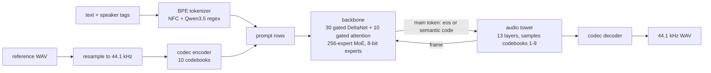

# drama3-mlx

A native C11 runtime for [Fish Audio Drama 3](https://huggingface.co/fishaudio/drama-3) (35B-parameter MoE text-to-speech) on Apple silicon, built on [MLX](https://github.com/ml-explore/mlx) through its C API, [mlx-c](https://github.com/ml-explore/mlx-c).

Everything that runs at inference time is C: the BPE tokenizer, the Qwen3.5-MoE hybrid backbone, the codebook-MTP audio tower, sampling, the S2-Pro audio codec (encode and decode), long-text chunking and the CLI. Python is only used for the one-time weight conversion and for the parity tests against Fish's PyTorch reference.

- Voice cloning from reference audio, multi-speaker scenes (`<|speaker:0|>` … `<|speaker:15|>`), inline tags such as `[whisper]`, `[laughing]`, `[sighs]`, editing by continuing a previous take, and long text split into chunks that keep the voice.
- About 39 frames/s of decoding on an M4 Max (audio plays at 21.5 frames/s), so roughly 1.8× faster than real time.
- No dependencies beyond mlx-c.

## How it works



Each audio frame is one prompt row: the backbone predicts the frame's main (semantic) token, the tower fills in the remaining nine codebooks, and the frame is fed back to the backbone. Frames are 2048 samples at 44.1 kHz.

## Requirements

- Apple silicon Mac. The converted model needs about 38 GB of memory; it was developed on an M4 Max with 128 GB.
- [Homebrew](https://brew.sh) `mlx-c` (0.7.0) and `cmake`.
- Python 3.12 (with [uv](https://github.com/astral-sh/uv) or pip) for the conversion and the tests.
- Disk: 41 GB for the original checkpoint, 39 GB for the converted model.

## Build

```bash
brew install mlx-c cmake
```

```bash
cmake -S . -B build && cmake --build build -j
```

This builds `build/drama3-tts` (the CLI) and `build/libdrama3.dylib` (used by the tests).

## Get and convert the weights

The weights are not in this repository. Download them from Hugging Face and convert them once:

```bash
uv venv --python 3.12 .venv && uv pip install --python .venv/bin/python -r tools/requirements.txt huggingface_hub
```

```bash
.venv/bin/hf download fishaudio/drama-3 --local-dir checkpoints/drama-3
```

```bash
.venv/bin/python tools/convert.py --checkpoint checkpoints/drama-3 --output mlx_model
```

The converter:

- dequantizes the block-FP8 MoE experts exactly as Fish's reference does on non-CUDA devices and re-quantizes them to MLX 8-bit affine (group size 64); every other weight stays bf16;
- stores the zero-centered RMSNorm weights as fp32 `1 + w`;
- keeps only the `lm_head` rows decoding can sample (eos and the 4096 semantic tokens);
- folds the codec's weight norm in fp32 and writes `codec.safetensors` with MLX convolution layouts.

The model weights are subject to the [Fish Audio Community License](https://huggingface.co/fishaudio/drama-3/blob/main/LICENSE).

## Usage

Plain text to speech:

```bash
./build/drama3-tts tts --text "Hello! This is Drama 3 running on Apple silicon." --output hello.wav
```

Clone a voice from a reference clip and its transcript:

```bash
./build/drama3-tts tts --ref-audio me.wav --ref-text "Transcript of me.wav." --text "[whisper] Don't make a sound." --output whisper.wav
```

A scene with two cloned voices (the speaker tag in each transcript says which voice is which):

```bash
./build/drama3-tts tts --ref-audio alice.wav --ref-text "<|speaker:0|> Alice's transcript." --ref-audio bob.wav --ref-text "<|speaker:1|> Bob's transcript." --text "<|speaker:0|> [whisper] Did you hear that? <|speaker:1|> [laughing] Relax, it's just the cat!" --output scene.wav
```

Edit a line by continuing a previous take (the earlier take's codes come from `--save-codes`):

```bash
./build/drama3-tts tts --ref-audio me.wav --ref-text "Transcript of me.wav." --take-text "The report is due on Wednesday." --take-codes take1.npy --text "The report is due on Thursday." --output take2.wav
```

Encode or decode audio codes directly (`.npy`, compatible with fish-speech's `codes_N.npy`):

```bash
./build/drama3-tts encode --input clip.wav --output clip.npy
```

```bash
./build/drama3-tts decode --input clip.npy --output clip.wav
```

### Options

| Option | Default | Meaning |
|---|---|---|
| `--model DIR` | `mlx_model` | converted model directory |
| `--text`, `--text-file` | | text to speak |
| `--ref-audio PATH`, `--ref-codes PATH` | | reference clip (WAV) or its codes; repeatable |
| `--ref-text TEXT` | | transcript of each reference, in the same order |
| `--take-text`, `--take-codes` / `--take-audio` | | a previous take to continue from |
| `--save-codes PATH` | | also write the generated codes |
| `--temperature`, `--top-p`, `--top-k` | 0.7, 0.7, 30 | sampling (fish-speech's CLI defaults; SGLang-Omni uses 1.0, 0.9, 30) |
| `--max-new-tokens N` | 1024 | frames per text chunk; 0 means 600 (2048 with `--single-chunk`) |
| `--seed N` | 42 | random seed |
| `--single-chunk` | off | generate the whole text in one pass instead of chunks |
| `--codec-dtype` | `bfloat16` | `float32` matches Fish's codec exactly; `bfloat16` is what fish-speech's CLI runs |
| `--wav-bits` | 16 | 16-bit PCM or 32-bit float output |

Input audio must be WAV (8/16/24/32-bit PCM or 32/64-bit float, any sample rate, any channel count); it is averaged to mono and resampled the way torchaudio does.

Inline tags are free-form natural language in brackets, placed where the effect should land: `[whisper]`, `[laughing]`, `[sighs]`, `[angry]`, `[shouting]`, `[sad]`, `[crying]`, `[excited]`, `[pause]`, `[inhale]` and so on. Their effect is stochastic: a `[whisper]` is not whispered on every seed, and some cloned voices resist it.

## Accuracy

The runtime is checked component by component against Fish's PyTorch reference ([fish-speech](https://github.com/fishaudio/fish-speech) at `1ff3c3e`):

- **Tokenizer**: identical ids to Hugging Face `tokenizers` for every Unicode code point in eight contexts, 30k fuzzed strings and exhaustive NFC. The regex uses Unicode 16.0 tables (Oniguruma's) and NFC uses Unicode 9.0 (the normalization crate's), as the reference does.
- **Prompt rows and text chunking**: identical to fish-speech, including references, history turns, speaker tags, validation errors and 6,000 fuzzed chunking cases.
- **Backbone**: on identical inputs, each layer's deviation from an fp32 reference matches Fish's own bf16 run (median ratio 1.00, at most 1.07); chunked prefill of long prompts adds no error over a one-shot pass.
- **Audio tower**: teacher-forced codebook logits agree with the reference; the only argmax differences are near-ties. With top-k 1 a full decode step produces the same frame bit for bit.
- **Sampler**: same token distributions as the reference.
- **Codec**: in fp32, decoding matches Fish's DAC to 2e-6 relative error and encoding produces identical codes; the resampler matches torchaudio to 6e-8.
- **Reference audio**: WAV files at 16/22.05/24/44.1/48 kHz, int16/int24/float32, mono and stereo encode to exactly the codes fish-speech produces.
- **Cloning**: generations follow the reference voice (pitch within 15% of the reference's), dialogues switch voice with the speaker tag, and an edited take keeps the voice of the take it continues.

The 8-bit experts differ from the original FP8 experts by about 0.77% (relative Frobenius norm per matrix). bf16 computation mirrors the reference's casts, including fp32 where it uses fp32.

## Tests

```bash
uv pip install --python .venv/bin/python -r tests/requirements.txt
```

```bash
tests/setup_reference.sh && tests/data/make_fixtures.sh
```

```bash
.venv/bin/python -m pytest tests
```

The fixtures are made locally with macOS `say`. The first run computes Fish's fp32 and bf16 reference passes over a 700-row prompt and caches them in `tests/.cache` (25–30 minutes); later runs take about 10 minutes.

## Layout

| Path | Contents |
|---|---|
| `src/main.c` | CLI |
| `src/tokenizer.c`, `src/unicode.c`, `src/unicode_data.c` | byte-level BPE tokenizer, Unicode tables (generated by `tools/gen_unicode.c`) |
| `src/backbone.c` | gated DeltaNet (custom Metal kernel), gated attention, MoE |
| `src/tower.c`, `src/sampling.c` | audio tower and top-k / top-p sampling with repetition-aware resampling |
| `src/prompt.c`, `src/chunking.c`, `src/generate.c` | prompt rows, long-text chunking, generation loop |
| `src/codec.c`, `src/reference.c`, `src/resample.c`, `src/wav.c`, `src/npy.c` | codec, reference audio, I/O |
| `src/mlxu.c`, `src/weights.c`, `src/json.c` | mlx-c helpers, safetensors loading, JSON |
| `src/testapi.c` | entry points the tests call through ctypes |
| `tools/convert.py` | checkpoint conversion |
| `tests/` | parity and behaviour tests |
